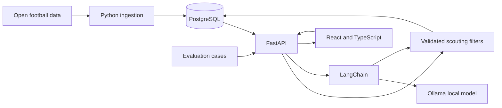

# Architecture

## First product slice

A scout enters a question or chooses filters in React. FastAPI turns accepted inputs into a typed filter object, queries PostgreSQL, and returns candidates with the metrics and source context used to rank them. The first working slice uses explicit filters so data and query correctness can be checked before a model is involved.

## AI boundary

LangChain will ask Ollama to map a question to a restricted filter schema and, later, draft a scouting summary from returned rows. FastAPI validates the schema and builds the SQL from allowlisted fields. The model does not issue SQL or invent unavailable player attributes. The API can still perform deterministic filter search when Ollama is stopped or its answer is invalid.

Report generation receives the exact returned metrics, units, competition/season, and source identifiers. Each factual claim must be traceable to that evidence. LangGraph enters only if a demonstrated multi-step path needs state, branching, or retries; it is not a Sprint 0 dependency.

## Local runtime and cost

The target development machine is an Apple M1 Pro with 16 GB memory. PostgreSQL and the API run locally; Ollama serves a downloaded model locally. The model and quantization will be chosen by measuring memory use, latency, filter accuracy, and report quality on this machine. The design requires no OpenAI API key.

## Decisions still open

- Which competitions and seasons from the open dataset make a useful first scouting sample.
- Which player metrics can be calculated reproducibly from the available event files.
- Which local model performs well enough on the evaluation set.
- Whether the completed workflow is complex enough to justify LangGraph.
