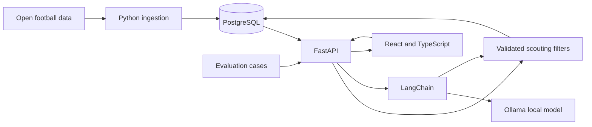

# Architecture

## First product slice

A scout enters a question or chooses filters in React. FastAPI turns accepted inputs into a typed filter object, queries PostgreSQL, and returns candidates with the metrics and source context used to rank them. The first working slice uses explicit filters so data and query correctness can be checked before a model is involved.

## AI boundary

LangChain asks local Ollama to map a question to a restricted filter schema. FastAPI validates the schema and builds the SQL from allowlisted fields. The interface shows a proposal and waits for the scout to apply it. The model does not issue SQL or invent unavailable player attributes; ambiguous requests ask for clarification and unsupported attributes are refused. Deterministic search remains available when Ollama is stopped or its answer is invalid.

The report lens receives the full eligible role cohort. The model may select a small set of supplied metric keys, but it cannot author metric values or free-form factual claims. FastAPI calculates peer medians and mid-rank percentiles, applies strength/watchpoint thresholds, and renders each claim with its metric definition, unit, sample, and pinned source revision. If Ollama is absent or gives an invalid selection, a deterministic evidence-only dossier remains available. LangGraph enters only if a demonstrated multi-step path needs state, branching, or retries; it is not required for this slice.

## Local runtime and cost

The target development machine is an Apple M1 Pro with 16 GB memory. PostgreSQL and the API run locally; Ollama serves a downloaded model locally. The current optional default is `qwen3.5:4b`, but the final selection remains open until filter accuracy, latency, and memory are measured on this machine. The design requires no OpenAI API key and only allows a loopback Ollama endpoint.

## Decisions still open

- Which competitions and seasons from the open dataset make a useful first scouting sample.
- Which player metrics can be calculated reproducibly from the available event files.
- Which local model performs well enough on the evaluation set.
- Whether the completed workflow is complex enough to justify LangGraph.
